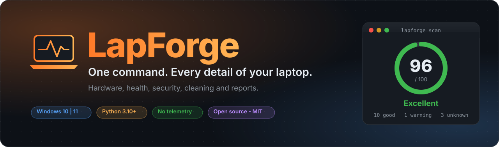
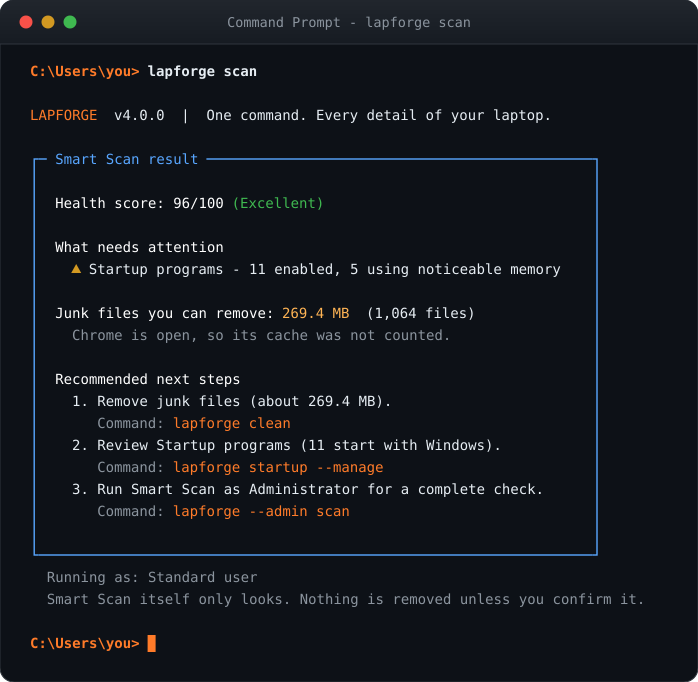
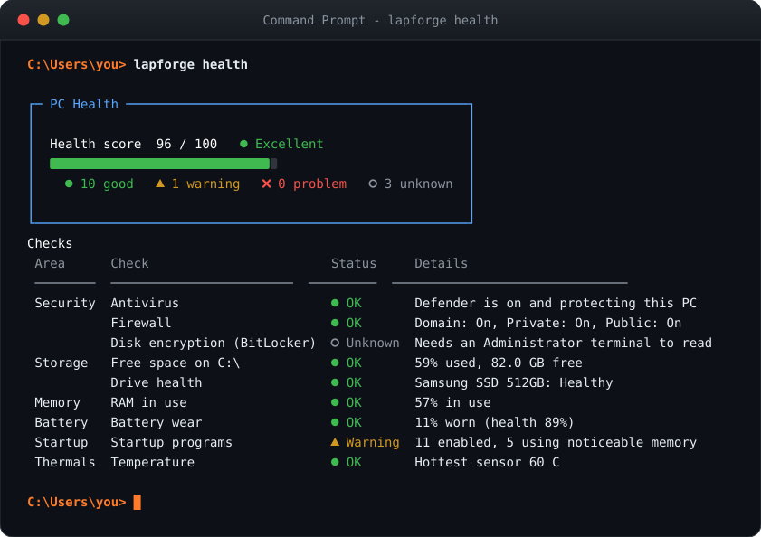
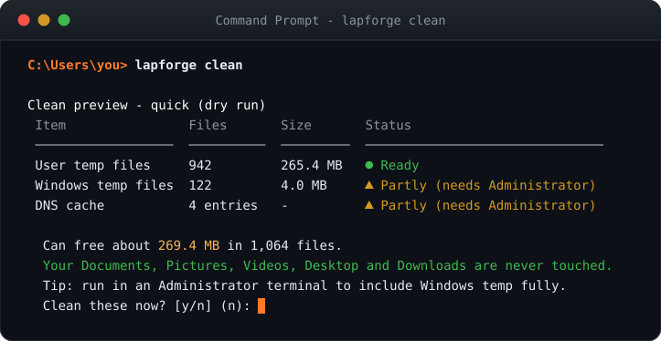
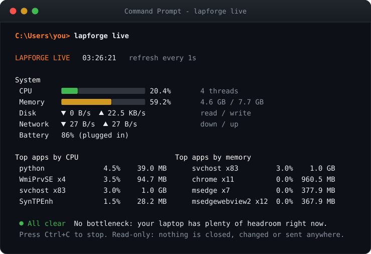
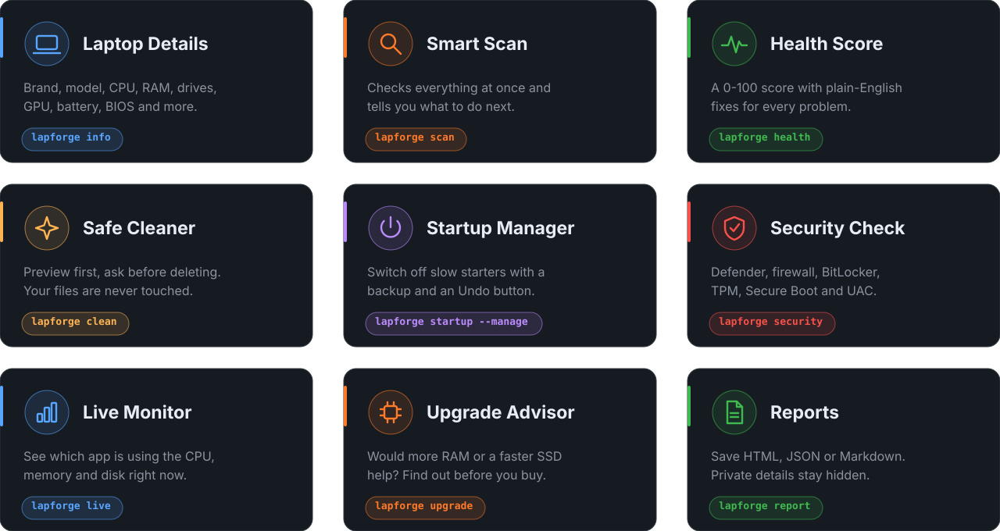
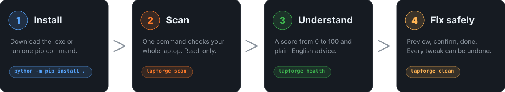
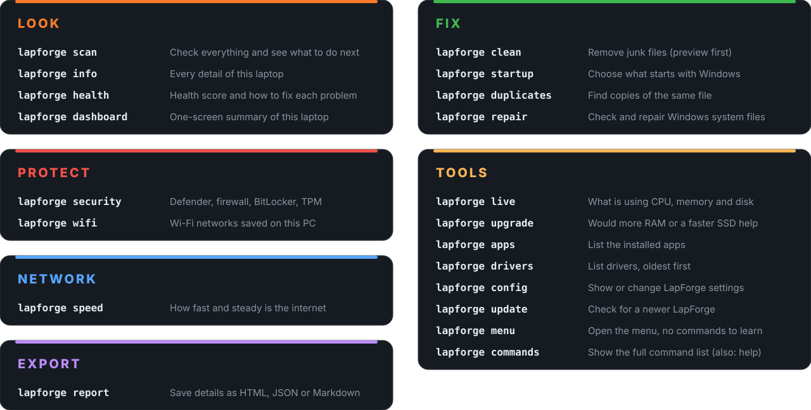
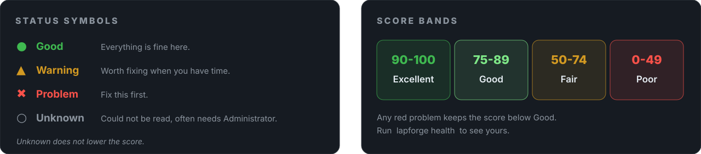
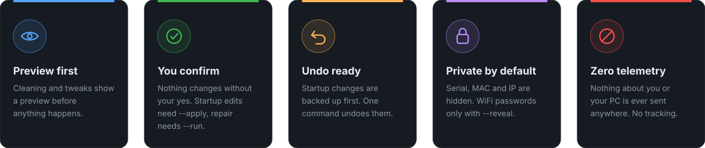

<div align="center">



<br>

[](https://github.com/BuildsByAliyan/lapforge/actions/workflows/ci.yml)


**A free, open-source tool that shows everything about your Windows laptop,<br>tells you in plain English what is wrong, and fixes the safe things for you.**

[Install](#-install) &nbsp;•&nbsp; [Quick start](#-quick-start) &nbsp;•&nbsp; [All commands](#-every-command-explained) &nbsp;•&nbsp; [Safety](#-safety-first) &nbsp;•&nbsp; [FAQ](#-faq-and-troubleshooting) &nbsp;•&nbsp; [Contribute](#-contributing)

</div>

> [!IMPORTANT]
> **For your own computer only.** LapForge is made to inspect and maintain the PC it runs on.
> Do not use it to read WiFi passwords or system details of a computer that is not yours.


## Contents

- [What is LapForge?](#-what-is-lapforge)
- [See it in action](#-see-it-in-action)
- [Features](#-features)
- [How it works](#-how-it-works)
- [Install](#-install)
- [Quick start](#-quick-start)
- [Every command explained](#-every-command-explained)
- [The menu (no commands to remember)](#-the-menu-no-commands-to-remember)
- [Run as Administrator](#-run-as-administrator)
- [How to read the results](#-how-to-read-the-results)
- [Reports](#-reports)
- [Settings](#-settings)
- [Safety first](#-safety-first)
- [FAQ and troubleshooting](#-faq-and-troubleshooting)
- [Known limitations](#-known-limitations)
- [For developers](#-for-developers)
- [For developers](#-for-developers)
- [Contributing](#-contributing)


## 💡 What is LapForge?

LapForge is a small program you run in the **Command Prompt**. You type a short command, and it shows you
clear, readable answers about your laptop:

- **What do I have?** Brand, model, processor, memory, drives, graphics, battery, BIOS and Windows version.
- **Is it healthy?** A score from 0 to 100, with a plain-English fix for every problem.
- **Is it safe?** Windows Security, firewall, disk encryption (BitLocker), TPM, Secure Boot.
- **Why is it slow?** Which app is using the processor or memory right now, and which programs slow down startup.
- **Can I clean it?** Remove junk files safely. LapForge shows a preview first and asks before it deletes anything.
- **Can I upgrade it?** Would more RAM or a faster SSD help? Find out before you spend money.

You do not need to be a technical person. Everything is explained in simple words, and if LapForge cannot read
something, it shows `N/A` instead of crashing.

**Who is it for?** Students, office users, shop owners and repair technicians who want to check a laptop in
a minute, and developers who like clean command-line tools.

### Why LapForge?

| Without LapForge | With LapForge |
|---|---|
| Open 6 different Windows screens to find your RAM, drive and battery health | One command: `lapforge info` |
| "Is my laptop healthy?" Nobody knows | One command: `lapforge health` gives a score and fixes |
| Cleaner apps full of ads that delete things without asking | Free, no ads, always shows a preview first |
| Unknown tools that send your data somewhere | **No telemetry.** Nothing about you or your PC is ever sent anywhere |
| Hard-to-understand technical error messages | Plain-English results and advice |


## 📸 See it in action

> These pictures show sample output. The numbers on your own laptop will be different.

**Smart Scan** checks everything at once and tells you what to do next:

<div align="center">

</div>

**Health** gives you a score and a clear table of every check:

<div align="center">

</div>

**Clean** shows a preview first and asks before it removes anything:

<div align="center">

</div>

<details>
<summary><b>More: the live monitor</b></summary>
<br>
<div align="center">

</div>
</details>


## ✨ Features



| Feature | What you get |
|---|---|
| **Laptop details** | Brand, model, CPU, RAM type and speed, drives, GPU, battery, BIOS, boot mode and more |
| **Smart Scan** | One command checks health, junk, startup programs and security, then lists the next steps |
| **Health score** | 0 to 100 with a colour for every check and a fix hint for every problem |
| **Battery and drive health** | Battery wear, SSD/HDD health, drive temperature and power-on hours (more detail as Administrator) |
| **Safe cleaner** | Quick clean, full clean, browser cache. Preview, confirm, clean, then a before/after report and a log |
| **Startup manager** | Switch off programs that slow down boot, with a backup, an optional restore point and Undo |
| **Duplicate finder** | Finds copies of the same file. It only reports, it never deletes |
| **Repair** | Guided Windows system file repair (DISM and SFC) |
| **Security overview** | Antivirus, firewall, BitLocker, TPM, Secure Boot, UAC |
| **Live monitor** | See which app is using CPU, memory and disk right now, and what is the bottleneck |
| **Upgrade advisor** | RAM slots, type and maximum, SSD advice, with the exact search to find your service manual |
| **Reports** | HTML (dark theme), JSON or Markdown. Private details are hidden by default |
| **Saved WiFi** | Current connection and saved networks. Passwords only when you ask with `--reveal` |


## 🔧 How it works



1. **Install** LapForge (download the `.exe`, or run one `pip` command).
2. **Scan** with `lapforge scan`. This only looks and never changes anything.
3. **Understand** the result: a health score and simple advice.
4. **Fix safely** with `lapforge clean` or `lapforge startup`. Each shows a preview first, and each change can be undone.


## 📦 Install


**You need:** Windows 10 or 11. Python 3.10 or newer (only for Option B and C, not for the `.exe`).

### Option A: Download the `.exe` (easiest, no Python needed)

1. Open the [**Releases page**](https://github.com/BuildsByAliyan/lapforge/releases/latest).
2. Download **`LapForge.exe`**.
3. Double-click it. The menu opens. That is all.

> [!NOTE]
> Windows may show a blue **"Windows protected your PC"** screen, because the file is new and not code-signed.
> Click **More info**, then **Run anyway**. To be extra careful, compare the file with the published checksum:
>
> ```powershell
> Get-FileHash .\LapForge.exe -Algorithm SHA256
> ```
>
> The result must match the SHA-256 shown in the release notes (the file `LapForge.exe.sha256` is attached too).

### Option B: Install with pip (recommended)

**Step 1. Install Python** from [python.org/downloads](https://www.python.org/downloads/).
On the first screen of the installer, **tick "Add python.exe to PATH"**.

**Step 2. Check it worked.** Open **Command Prompt** (press the Windows key, type `cmd`, press Enter) and run:

```
python --version
```

You should see `Python 3.10` or higher.

**Step 3. Get the project.** Either use git:

```
git clone https://github.com/BuildsByAliyan/lapforge.git
cd lapforge
```

or on GitHub click **Code → Download ZIP**, extract it, and open Command Prompt inside the extracted folder
(in File Explorer type `cmd` in the address bar and press Enter).

**Step 4. Install:**

```
python -m pip install .
```

**Step 5. Run it:**

```
python -m lapforge
```

That opens the menu. To check that everything is fine, run `python -m lapforge --version`.

> [!TIP]
> **Windows says `'pip' is not recognized` or `'lapforge' is not recognized`?** This is very common and easy to fix.
> Always put `python -m` in front: `python -m pip install .` and `python -m lapforge scan`. It works on every PC.
> If you want to type just `lapforge`, add the folder shown in pip's warning
> (for example `...\Python\Scripts`) to your PATH, then open a new Command Prompt.

### Option C: Run from source (no install)

```
pip install -r requirements.txt
python -m lapforge
```

Or double-click **`Start-LapForge.bat`**. On the first start it installs the two helper packages (`psutil` and `rich`) for you.

### Update and uninstall

```
python -m pip install . --upgrade       # after downloading a newer version of the project
python -m pip uninstall lapforge        # remove the program
```

LapForge keeps three small things on your PC. Delete them if you want a completely clean removal:

| What | Where |
|---|---|
| Saved reports | `%USERPROFILE%\LapForge\Reports` |
| Settings | `%APPDATA%\LapForge\config.json` |
| Run logs of clean and repair | `%LOCALAPPDATA%\LapForge\logs` |


## 🚀 Quick start

You only need to remember **five** commands:

```
lapforge scan             # 1. Check everything and see what to do next
lapforge info             # 2. Every detail of your laptop
lapforge health           # 3. Health score and how to fix each problem
lapforge clean --dry-run  # 4. Preview the junk files. Deletes nothing
lapforge report           # 5. Save a report you can keep or share
```

Not sure where to start? Just type **`lapforge`** and press Enter. The numbered menu opens.

> [!NOTE]
> In this README commands are written as `lapforge ...`. If your PC says *"lapforge is not recognized"*,
> write `python -m lapforge ...` instead. It is exactly the same thing.


## 📚 Every command explained



### Cheat sheet

| Command | What it is for | Changes your PC? |
|---|---|---|
| `lapforge` | Opens the numbered menu | Only if you pick an action |
| [`lapforge scan`](#scan) | Check everything and see what to do next | No (asks before cleaning) |
| [`lapforge info`](#info) | Every detail of this laptop | No |
| [`lapforge health`](#health) | Health score and how to fix each problem | No |
| [`lapforge dashboard`](#dashboard) | One-screen summary | No |
| [`lapforge clean`](#clean) | Remove junk files | **Yes, after a preview and your yes** |
| [`lapforge startup`](#startup) | Choose which programs start with Windows | **Yes, only with `--apply`**, and undoable |
| [`lapforge duplicates`](#duplicates) | Find copies of the same file | No (never deletes) |
| [`lapforge repair`](#repair) | Check and repair Windows system files | **Yes, only with `--run`** |
| [`lapforge security`](#security) | Defender, firewall, BitLocker, TPM, Secure Boot, UAC | No |
| [`lapforge wifi`](#wifi) | Current WiFi and saved networks | No |
| [`lapforge speed`](#speed) | Internet quality (ping and latency) | No |
| [`lapforge report`](#report) | Save details as HTML, JSON or Markdown | Writes one report file |
| [`lapforge live`](#live) | Live CPU, memory and disk monitor | No |
| [`lapforge upgrade`](#upgrade) | Would more RAM or a faster SSD help? | No |
| [`lapforge apps`](#apps) | List installed apps | No |
| [`lapforge drivers`](#drivers) | List drivers, oldest first | No |
| [`lapforge config`](#config) | Show or change LapForge settings | Only LapForge's own settings file |
| [`lapforge update`](#update) | Check if a newer LapForge exists | No |
| [`lapforge menu`](#menu) | Open the numbered menu | Only if you pick an action |
| [`lapforge commands`](#commands) | Show the command list (also `help`) | No |

**Options that work with every command**

| Option | Meaning |
|---|---|
| `-h`, `--help` | Show help for LapForge or for one command, e.g. `lapforge clean --help` |
| `-V`, `--version` | Show the version number |
| `--debug` | If something goes wrong, show the technical details (useful for bug reports) |
| `--admin` | Run this command as Administrator. Windows shows its permission prompt |

Click a group below to open the full explanation of each command.

<details>
<summary><b>LOOK</b> &nbsp;·&nbsp; scan, info, health, dashboard</summary>

<a id="scan"></a>
#### `lapforge scan` (also: `lapforge check`)

**Smart Scan.** Checks your whole laptop in one go (health, junk files, startup programs, security) and lists
the next steps in the order that helps most. **The best first command.**

| | |
|---|---|
| **Use it when** | You want a quick check-up and do not know where to start |
| **Changes your PC?** | No. At the end it asks "Remove the junk files now? [y/n]". Press **n** to skip |
| **Administrator?** | Optional. `lapforge --admin scan` gives a more complete check |
| **Options** | None |

<a id="info"></a>
#### `lapforge info`

Shows **every detail** of the laptop: system, BIOS and motherboard, processor, memory, physical drives,
volumes, graphics, battery and temperatures.

| Option | Meaning |
|---|---|
| `--show-serial` | Also show the serial numbers (hidden by default for your privacy) |

As Administrator you also see the drive temperature, life used and power-on hours.

<a id="health"></a>
#### `lapforge health`

Shows the **Health score (0 to 100)**, a table of every check, and "How to fix" advice for each problem.
See [How to read the results](#-how-to-read-the-results).

| Option | Meaning |
|---|---|
| `--fail-on never` (default) | Always finish normally |
| `--fail-on warn` | Exit with code 1 if there is a warning or a problem (for scripts) |
| `--fail-on bad` | Exit with code 1 only if there is a serious problem (for scripts) |

As Administrator, BitLocker and TPM are checked too (otherwise they show as `Unknown`).

<a id="dashboard"></a>
#### `lapforge dashboard`

The one-screen summary of this laptop: logo and key facts side by side.

</details>

<details>
<summary><b>FIX</b> &nbsp;·&nbsp; clean, startup, duplicates, repair</summary>

<a id="clean"></a>
#### `lapforge clean`

Removes **junk files**. The steps are always the same: **Preview → you confirm → clean → before/after report**.
Every run is saved in a log.

| What gets cleaned | Quick (default) | `--full` | `--browser` |
|---|:---:|:---:|:---:|
| Your temp files | ✅ | ✅ | ✅ |
| Windows temp files | ✅ | ✅ | ✅ |
| DNS cache | ✅ | ✅ | ✅ |
| Prefetch files | | ✅ | |
| Windows update download cache | | ✅ | |
| Thumbnail cache | | ✅ | |
| Recycle Bin (permanent!) | | ✅ | |
| Chrome and Edge cache | | | ✅ |

| Option | Meaning |
|---|---|
| `--dry-run` | **Only show the preview. Delete nothing.** Start with this |
| `--full` | Full clean (adds Prefetch, update cache, thumbnails, Recycle Bin) |
| `--browser` | Also clear Chrome and Edge **cache** (never cookies, passwords or history) |
| `-y`, `--yes` | Do not ask for confirmation (the preview is still shown) |

- Your **Documents, Pictures, Videos, Desktop and Downloads are never touched.**
- If Chrome or Edge is open, LapForge says so and does not count its cache. Close the browser and run it again.
- **Administrator** is needed to clean Windows temp files, Prefetch and the update cache completely.

<a id="startup"></a>
#### `lapforge startup`

Lists the programs that **start with Windows**, heaviest first. Fewer startup programs means a faster boot.
"Impact" is judged by the memory a program uses right now.

| Option | Meaning |
|---|---|
| *(none)* | Just list the startup programs |
| `--manage` | **Interactive mode:** switch programs on or off with preview, backup, restore point and Undo |
| `--disable NAME` | Turn the program `NAME` off. Preview only unless you add `--apply` |
| `--enable NAME` | Turn the program `NAME` back on. Preview only unless you add `--apply` |
| `--source {registry-user,registry-all,folder-user,folder-all}` | Pick one entry if the same name exists in more than one place |
| `--undo [CHANGE_ID]` | Undo a change (the newest one by default). Preview only unless `--apply` |
| `--history` | List the changes LapForge made (each one can be undone) |
| `--apply` | **Really do** the `--disable`, `--enable` or `--undo` |
| `--no-restore-point` | Skip the System Restore point (the backup is still saved) |
| `-y`, `--yes` | Do not ask for confirmation (the preview is still shown) |

Example: `lapforge startup --disable "OneDrive"` shows what would happen. Add `--apply` to really do it,
and `lapforge startup --undo --apply` to bring it back.

Windows Security items are refused. Items that start for **all users** need an Administrator terminal.

<a id="duplicates"></a>
#### `lapforge duplicates`

Finds files that are **exact copies** of each other and tells you how much space they waste.
**It never deletes anything.** You decide what to do.

| Option | Meaning |
|---|---|
| `--path FOLDER` | Folder to scan. Can be used more than once. Default: your Downloads folder |
| `--min-size MB` | Ignore files smaller than this many megabytes (default 1) |
| `--max-files N` | Stop after looking at N files (default 200000) |

<a id="repair"></a>
#### `lapforge repair`

A guided **Windows system file repair** (DISM and SFC). Without `--run` it only **shows the plan**.

| Option | Meaning |
|---|---|
| `--mode check` (default) | Read-only scan: DISM quick check, DISM full scan, SFC verify only |
| `--mode repair` | Repair: DISM RestoreHealth, then SFC `/scannow` |
| `--run` | **Actually run it.** Needs an Administrator terminal |
| `-y`, `--yes` | Do not ask for confirmation when using `--run` |

Each step can take 5 to 15 minutes (repair can take 20 minutes or more). Keep the laptop plugged in.

</details>

<details>
<summary><b>PROTECT and NETWORK</b> &nbsp;·&nbsp; security, wifi, speed</summary>

<a id="security"></a>
#### `lapforge security`

Shows the status of **Windows Security**: antivirus (Defender or another antivirus such as 360 Total Security),
firewall, BitLocker disk encryption, TPM, Secure Boot and User Account Control (UAC).

- BitLocker and TPM need an **Administrator** terminal, otherwise they show `Unknown`.
- Older laptops with **Legacy BIOS** do not support Secure Boot. LapForge shows "Not supported (Legacy BIOS)".

<a id="wifi"></a>
#### `lapforge wifi`

Shows your **current WiFi** (name, signal, radio, security, link speed) and the list of **saved WiFi networks**
on this PC.

| Option | Meaning |
|---|---|
| `--reveal` | Show the saved WiFi passwords. This PC only, Administrator terminal needed |

Passwords are hidden by default. They are never saved to disk or written to logs.

<a id="speed"></a>
#### `lapforge speed`

Tests how fast and steady your **internet connection** is: ping and latency to Cloudflare (`1.1.1.1`),
Google DNS (`8.8.8.8`) and `google.com`, plus how long a DNS lookup takes. It only sends pings. Nothing about you.

</details>

<details>
<summary><b>EXPORT</b> &nbsp;·&nbsp; report</summary>

<a id="report"></a>
#### `lapforge report`

Saves all the laptop details as a **file you can keep or share** (for example to send to a repair technician).
By default an HTML report is saved in `%USERPROFILE%\LapForge\Reports`.

| Option | Meaning |
|---|---|
| `--format {html,json,md,all}` | Report format. Default: `html` (or the one matching the `-o` file name) |
| `-o PATH`, `--output PATH` | A folder, or a file name ending in `.html`, `.json` or `.md` |
| `--show-private` | Include serial numbers, MAC and IP addresses (hidden by default) |
| `--no-apps` | Leave the installed apps list out |
| `--drivers` | Include the driver list (can take up to a minute) |
| `--open` | Open the HTML report in your browser when it is done |
| `--force` | Overwrite the `-o` file if it already exists |

Examples: `lapforge report --open`, `lapforge report --format all`, `lapforge report -o D:\Backup\mylaptop.md`

</details>

<details>
<summary><b>TOOLS</b> &nbsp;·&nbsp; live, upgrade, apps, drivers, config, update, menu, commands</summary>

<a id="live"></a>
#### `lapforge live`

A **live monitor**: CPU, memory, disk, network and battery, the apps using the most, and a "What is slowing it
down?" box that finds the bottleneck. Press **Ctrl + C** to stop. It is read-only: nothing is closed or changed.

| Option | Meaning |
|---|---|
| `--interval SECONDS` | Refresh every SECONDS (0.5 to 10, default 1) |
| `--top N` | How many apps to list in each table (3 to 10, default 5) |
| `--duration SECONDS` | Stop by itself after SECONDS (default: run until Ctrl+C) |
| `--once` | No live screen: watch for a few seconds, print what is slowing the laptop down, then exit |

<a id="upgrade"></a>
#### `lapforge upgrade`

The **upgrade advisor**. Tells you if the laptop can take more RAM (free slots, memory type and speed, maximum,
soldered or not, single or dual channel) and whether a bigger or faster drive would help. It gives you the exact
search words to find your service manual. **Read-only.** Check the manual and your warranty before you buy parts.

<a id="apps"></a>
#### `lapforge apps`

Lists the **installed apps** with version, publisher, install date and size.

| Option | Meaning |
|---|---|
| `--sort {name,size,date}` | Sort order (default: `name`) |
| `--search TEXT` | Only show apps whose name or publisher contains TEXT |
| `--all` | Show every app (default: the first 40) |

<a id="drivers"></a>
#### `lapforge drivers`

Lists the **drivers**, oldest first, with their age. An old driver is **not always a problem**. If something
misbehaves, update the graphics, network and chipset drivers from your laptop maker's website.

| Option | Meaning |
|---|---|
| `--all` | Show every driver (default: the oldest 25) |

<a id="config"></a>
#### `lapforge config`

Shows or changes LapForge's own settings. See [Settings](#-settings).

| Action | Meaning |
|---|---|
| `lapforge config` or `lapforge config show` | Show all settings |
| `lapforge config set <setting> <value>` | Change one setting |
| `lapforge config reset` | Go back to the default settings |
| `lapforge config path` | Show where the settings file is |

<a id="update"></a>
#### `lapforge update`

Checks GitHub for a **newer LapForge**. It makes one read-only request and sends nothing about you.

<a id="menu"></a>
#### `lapforge menu`

Opens the **numbered menu**. No commands to remember. It also opens by itself when you type just `lapforge`
in a terminal, or when you double-click `LapForge.exe`. See [the menu](#-the-menu-no-commands-to-remember).

<a id="commands"></a>
#### `lapforge commands` (also: `lapforge help`)

Shows the short list of every command, grouped by what it does. For one command use, for example,
`lapforge help clean` or `lapforge clean --help`.

</details>


## 🧭 The menu (no commands to remember)

Type `lapforge` (or double-click `LapForge.exe`) and press a number:

| Key | Menu | What is inside |
|:---:|---|---|
| **1** | Smart Scan (recommended) | Checks everything and tells you what to do next |
| **2** | My Laptop | Details, battery, drives and upgrade options |
| **3** | Clean and Speed Up | Clean junk files, startup programs, duplicate files, live monitor |
| **4** | Security and Network | Windows Security, internet quality and WiFi |
| **5** | Repair Windows | Check and repair Windows system files |
| **6** | Reports and Settings | Save a report, change settings, look for updates |

Keys inside the menus: **0** (or **b**) goes back, **q** quits, and **A** restarts LapForge as Administrator
when that option is shown. Items marked **[Admin]** need an Administrator terminal.


## 🔐 Run as Administrator

Most things work in a normal Command Prompt. A few need more rights. Without them, LapForge never fails. It shows
`Unknown` or `N/A` and tells you what to do.

| You get this extra | Needs Administrator |
|---|:---:|
| BitLocker and TPM status in `health` and `security` | ✅ |
| Drive temperature, life used and power-on hours in `info` | ✅ |
| Cleaning Windows temp files, Prefetch and the update cache | ✅ |
| `repair --run` | ✅ |
| `wifi --reveal` (show saved passwords) | ✅ |
| Switching startup items that start for all users | ✅ |

**Two ways to run as Administrator:**

1. Press the Windows key, type `cmd`, **right-click** *Command Prompt*, choose **Run as administrator**,
   then use `cd` to go to the project folder.
2. Or add `--admin` to a command: `lapforge --admin scan`. Windows asks for permission.


## 🎯 How to read the results



`lapforge health` checks these areas:

| Area | What is checked |
|---|---|
| **Security** | Antivirus, firewall, disk encryption (BitLocker), TPM, Secure Boot, User Account Control |
| **Storage** | Free space on each drive, drive health |
| **Memory** | RAM in use, installed RAM |
| **Battery** | Battery wear (how much capacity is lost) |
| **Startup** | How many programs start with Windows and how much memory they use |
| **Thermals** | The hottest temperature sensor |

Every problem comes with **"What this means"** and **"What to do"** in plain words.


## 📄 Reports

`lapforge report` saves a file with all the details of your laptop. The file stays on your computer. LapForge
never uploads it.

| Format | Best for |
|---|---|
| **HTML** (default) | Reading in a browser. Dark theme, easy to share |
| **JSON** | Programs and scripts |
| **Markdown** | Pasting into a support ticket or a GitHub issue |

**Privacy:** serial numbers, MAC and IP addresses are **left out** unless you add `--show-private`.
Share reports made with `--show-private` carefully.


## 🧩 Settings

```
lapforge config                       # show all settings
lapforge config set theme mono        # change one setting
lapforge config set check_updates off
lapforge config path                  # where the settings file is
lapforge config reset                 # back to the defaults
```

| Setting | Values | Default | Meaning |
|---|---|---|---|
| `theme` | `dark`, `mono` | `dark` | Colour theme. `mono` uses no colours |
| `language` | `en` | `en` | Display language (only English for now) |
| `check_updates` | `on`, `off` | `on` | Check GitHub once a day for a newer version |
| `report_dir` | any folder | `%USERPROFILE%\LapForge\Reports` | Where reports are saved |
| `show_tips` | `on`, `off` | `on` | Show a short tip after common commands |


## 🔒 Safety first



LapForge is built so that **nothing happens behind your back**.

- **Preview first.** Cleaning and startup changes show what will happen before anything is touched.
  `clean` has `--dry-run`. `startup` changes need `--apply`. `repair` needs `--run`. All ask for confirmation.
- **Your files stay yours.** Documents, Pictures, Videos, Desktop and Downloads are never touched.
  Browser cleaning only clears cache, never cookies, passwords or history.
- **Duplicates are never auto-deleted.** The duplicate finder only reports.
- **Every tweak can be undone.** Before a startup change LapForge saves a backup and (unless you skip it)
  creates a System Restore point. `lapforge startup --undo --apply` reverses it.
- **WiFi passwords only on request.** Only with `--reveal`, only for the PC LapForge runs on, never written to disk or logs.
- **Private details are hidden by default.** Serial numbers, MAC and IP addresses stay out of the screen output and reports.
- **No telemetry.** LapForge sends nothing about you or your PC anywhere.
- **One optional network request.** Once a day LapForge can ask GitHub whether a newer version exists. Nothing about you is sent.
  Turn it off with `lapforge config set check_updates off`. The `speed` command only pings public servers when you run it.

More details, and how to report a security problem, are in [SECURITY.md](SECURITY.md).


## ❓ FAQ and troubleshooting

<details>
<summary><b>"'pip' is not recognized" or "'lapforge' is not recognized"</b></summary>

Put `python -m` in front: `python -m pip install .` and `python -m lapforge scan`. This always works.
If you want to type only `lapforge`, add Python's `Scripts` folder to your PATH (pip prints its location in a
warning after the install) and open a new Command Prompt.
</details>

<details>
<summary><b>"python" is not recognized, or it opens the Microsoft Store</b></summary>

Install Python from [python.org/downloads](https://www.python.org/downloads/) and tick **"Add python.exe to PATH"**
on the first screen. Then close and reopen Command Prompt and run `python --version`.
</details>

<details>
<summary><b>Some checks say "Unknown" or "N/A"</b></summary>

That is normal and does not lower your score. Usually LapForge needs an **Administrator** terminal to read them
(BitLocker, TPM, drive temperature). Some laptops simply do not provide a value (for example Secure Boot on an
older Legacy BIOS laptop). LapForge shows `N/A` instead of failing.
</details>

<details>
<summary><b>The junk size is smaller than I expected, or says "Chrome is open"</b></summary>

LapForge does not count (or touch) the cache of a browser that is open. Close Chrome and Edge, then run the command again.
For the Windows temp files, Prefetch and update cache, use an Administrator terminal.
</details>

<details>
<summary><b>Windows blocked LapForge.exe ("Windows protected your PC")</b></summary>

The file is new and not code-signed. Click **More info**, then **Run anyway**. You can compare the file with the
SHA-256 checksum from the release page first (see [Option A](#option-a-download-the-exe-easiest-no-python-needed)).
</details>

<details>
<summary><b>The WiFi password is not shown</b></summary>

Passwords are hidden on purpose. Use an Administrator terminal and run `lapforge wifi --reveal`. This works only for
the PC you are on.
</details>

<details>
<summary><b>Is it safe to run <code>lapforge clean</code>?</b></summary>

Yes. It shows a **preview** first and asks before it deletes. It never touches Documents, Pictures, Videos, Desktop
or Downloads. To be extra careful, run `lapforge clean --dry-run` first. It deletes nothing.
</details>

<details>
<summary><b>Does it work on Mac or Linux?</b></summary>

LapForge is made for **Windows 10 and 11**. On other systems most checks show `N/A` instead of failing.
</details>

<details>
<summary><b>Where are my settings, reports and logs?</b></summary>

Run `lapforge config path` for the settings file. Reports go to `%USERPROFILE%\LapForge\Reports`
and logs to `%LOCALAPPDATA%\LapForge\logs`. See [Update and uninstall](#update-and-uninstall).
</details>

<details>
<summary><b>Something went wrong. How do I report it?</b></summary>

Run the same command again with `--debug` (for example `lapforge health --debug`) and open an
[issue](https://github.com/BuildsByAliyan/lapforge/issues) with the text it shows. Remove private details first
(serial numbers, network names).
</details>


## 📝 Known limitations

- **WiFi names in other alphabets.** LapForge reads WiFi names from Windows `netsh`, which cannot always print other
  alphabets correctly. LapForge repairs the common cases (Urdu, Arabic, special letters), but a very unusual name may
  still show odd letters, and its details as `N/A`. Everything else still works.
- **Windows only.** Most checks need Windows 10 or 11.
- **The `.exe` is not code-signed yet.** Windows may show a warning the first time. See the FAQ above.


## 💻 For developers

### Run the tests

```
python -m pip install -e ".[dev]"
python -m pytest
```

The tests do **not** need Windows. GitHub Actions runs them on Windows and Linux for every change, and builds the `.exe`.

### Build the `.exe` yourself

Double-click **`build_exe.bat`**. It installs PyInstaller and creates **`dist\LapForge.exe`**, which runs without Python.

### Project structure

```
lapforge/
├── .readme/               Images used by this README (small SVG files)
├── .github/               CI, release workflow, issue and pull request templates
├── docs/                  Roadmap
├── lapforge/              The program
│   ├── cli.py             Commands and options
│   ├── app.py             Start-up, error handling, double-click behaviour
│   ├── smartscan.py       The Smart Scan
│   ├── collectors/        Read-only readers: hardware, BIOS, battery, disks, network, security, software
│   ├── doctor/            Health checks, 0-100 score, fix hints
│   ├── cleaner/           Junk cleaning, browser cache, duplicates, repair, logs
│   ├── optimizer/         Startup manager, restore points, upgrade advisor
│   ├── export/            HTML, JSON and Markdown reports
│   └── ui/                Menu, banner, tables, live monitor, plain-English glossary
├── tests/                 Automatic tests (pytest)
├── build_exe.bat          Builds the single .exe
├── Start-LapForge.bat     Double-click launcher
└── pyproject.toml         Package settings
```

### Roadmap

See [docs/ROADMAP.md](docs/ROADMAP.md).


## 🤝 Contributing

Bug reports, ideas and pull requests are welcome.

1. Read [CONTRIBUTING.md](CONTRIBUTING.md). It is short.
2. Open an [issue](https://github.com/BuildsByAliyan/lapforge/issues) for a bug or idea, or send a pull request.
3. Please keep the rules: **preview first, ask before changing, nothing is sent anywhere, personal files are never touched.**

Found a security problem? Please do not open a public issue. Read [SECURITY.md](SECURITY.md).

## 📜 License

[MIT](LICENSE). Free to use, change and share.

<div align="center">

<br>

**Made with care by [Aliyan Saleem](https://github.com/BuildsByAliyan)**

If LapForge helped you, please ⭐ **star the repository**. It helps other people find it.

</div>
